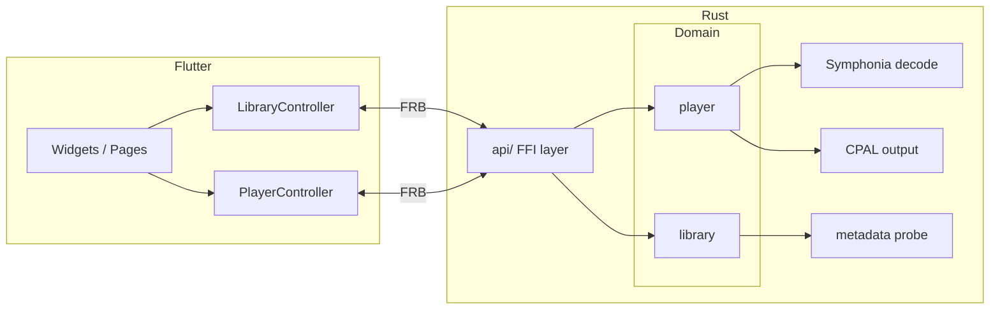

# mofu

Local music player.

[中文](README.md)

## Features

- **Library management**: scan local music directories or add audio files manually; supports directory playlists and user-created virtual playlists
- **Playback controls**: play / pause / stop, seek, volume, playback queue
- **Playback modes**: sequential, shuffle, repeat one, repeat all
- **Metadata**: title, artist, album, cover art, and other tags
- **Lyrics**: embedded lyrics (ID3 USLT, Vorbis, etc.) and sibling `.lrc` files; synchronized scrolling on the now-playing page

## Tech stack

| Layer | Technology |
|---|---|
| UI | Flutter 3, Provider, go_router |
| Bridge | flutter_rust_bridge 2.12 |
| Audio decoding | [Symphonia](https://github.com/pdeljanov/Symphonia) |
| Audio output | [CPAL](https://github.com/RustAudio/cpal) |
| Library persistence | JSON manifest (`library.json`) |
| Languages | Dart, Rust (Edition 2024) |

## Architecture



The Rust side is split by domain: `library` manages the persistent library and playlists; `player` runs decoding and output on a dedicated worker thread. Modules interact through traits and plain data DTOs; FFI types live in `rust/src/api/`.

## Project structure

```
mofu/
├── lib/                    # Flutter app
│   ├── app/                # theme, routing, root widget
│   ├── features/           # home, now-playing
│   ├── library/            # library controller
│   ├── player/             # player controller
│   ├── widgets/            # shared widgets (playback bar, cover, etc.)
│   └── src/rust/           # FRB-generated Dart bindings
├── rust/                   # Rust core library
│   └── src/
│       ├── api/            # FFI entry points (library, player)
│       ├── library/        # library domain logic
│       └── player/         # player domain logic
├── rust_builder/           # Flutter plugin; CargoKit builds Rust
├── test/                   # widget tests
└── integration_test/       # integration tests
```

## Requirements

- [Flutter SDK](https://docs.flutter.dev/get-started/install) (Dart ^3.5)
- [Rust toolchain](https://www.rust-lang.org/tools/install) (stable, Edition 2024)
- Platform-native build dependencies (Linux desktop needs CMake, Ninja, GTK, etc.; see [Flutter desktop docs](https://docs.flutter.dev/platform-integration/linux/setup))

## Quick start

```bash
# Fetch dependencies
flutter pub get

# Run (Linux example)
flutter run -d linux
```

The first build compiles the native library under `rust/` via CargoKit and may take a while.

## Development

### Run tests

```bash
# Rust unit tests
cargo test --manifest-path rust/Cargo.toml

# Flutter widget tests
flutter test

# Integration tests (device required)
flutter test integration_test/simple_test.dart -d linux
```

### Regenerate FRB bindings

After changing `rust/src/api/`, regenerate the Dart / Rust glue code:

```bash
flutter_rust_bridge_codegen generate
```

See [`flutter_rust_bridge.yaml`](flutter_rust_bridge.yaml) for configuration.

### Rust conventions

When contributing Rust code, follow the conventions in [`AGENTS.md`](AGENTS.md) (module boundaries, error handling, formatting, etc.).

## Supported audio formats

Library scanning and playback support common extensions:

`aac` `aiff` `alac` `flac` `m4a` `mp3` `mp4` `ogg` `opus` `wav` `webm` `wma`

Actual decoding is provided by Symphonia; refer to its documentation for codec support details.

## Data storage

The library manifest is stored by default as `library.json` in the platform application data directory:

- Application ID: `dev.mofu.mofu`
- Use `Library::new_at` to specify a custom data directory (tests and integration scenarios)

## Platform support

The project includes Flutter platform directories for Linux, Windows, and macOS. Development and testing focus on **Linux desktop**; other platforms should build in theory but are not fully verified.
