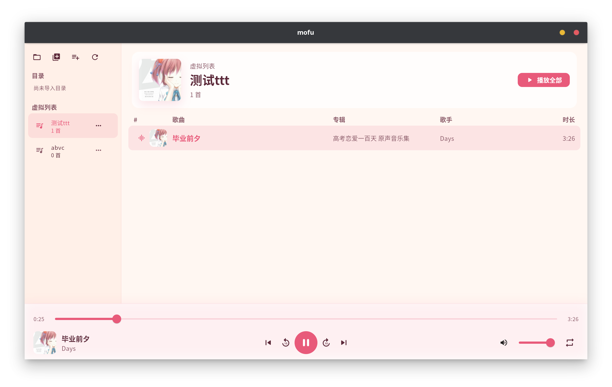
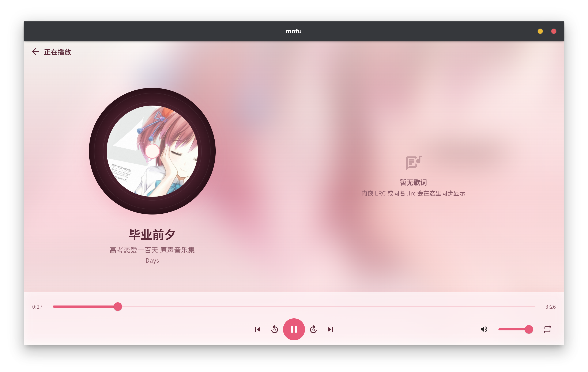
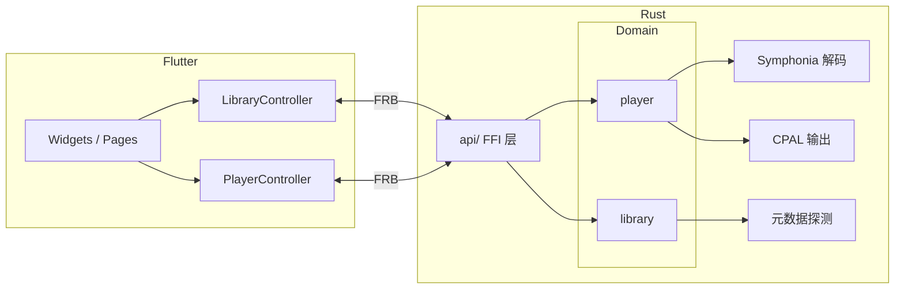

# mofu

本地音乐播放器。

[English](README.en.md)

<p align="center">
  
  &nbsp;
  
</p>

## 功能

- **曲库管理**：扫描本地音乐目录，或手动添加音频文件；支持目录播放列表与用户自建虚拟播放列表
- **播放控制**：播放 / 暂停 / 停止、进度跳转、音量调节、播放队列
- **播放模式**：顺序、随机、单曲循环、列表循环
- **元数据**：读取标题、歌手、专辑、封面等标签
- **歌词**：支持内嵌歌词（ID3 USLT、Vorbis 等）与同目录 `.lrc` 文件；正在播放页同步滚动显示

## 技术栈

| 层 | 技术 |
|---|---|
| UI | Flutter 3、Provider、go_router |
| 桥接 | flutter_rust_bridge 2.12 |
| 音频解码 | [Symphonia](https://github.com/pdeljanov/Symphonia) |
| 音频输出 | [CPAL](https://github.com/RustAudio/cpal) |
| 曲库持久化 | JSON manifest（`library.json`） |
| 语言 | Dart、Rust（Edition 2024） |

## 架构



## 项目结构

```
mofu/
├── lib/                    # Flutter 应用
│   ├── app/                # 主题、路由、根 Widget
│   ├── features/           # 首页、正在播放页
│   ├── library/            # 曲库控制器
│   ├── player/             # 播放控制器
│   ├── widgets/            # 共用组件（底栏、封面等）
│   └── src/rust/           # FRB 生成的 Dart 绑定
├── rust/                   # Rust 核心库
│   └── src/
│       ├── api/            # FFI 入口（library、player）
│       ├── library/        # 曲库领域逻辑
│       └── player/         # 播放器领域逻辑
├── rust_builder/           # Flutter 插件，CargoKit 构建 Rust
├── test/                   # Widget 测试
└── integration_test/       # 集成测试
```

## 环境要求

- [Flutter SDK](https://docs.flutter.dev/get-started/install)（Dart ^3.5）
- [Rust 工具链](https://www.rust-lang.org/tools/install)（stable，支持 Edition 2024）
- 各平台原生构建依赖（Linux 桌面需 CMake、Ninja、GTK 等，见 [Flutter 桌面文档](https://docs.flutter.dev/platform-integration/linux/setup)）

## 快速开始

```bash
# 获取依赖
flutter pub get

# 运行（以 Linux 为例）
flutter run -d linux
```

首次构建会通过 CargoKit 编译 `rust/` 下的原生库，耗时可能较长。

## 开发

### 运行测试

```bash
# Rust 单元测试
cargo test --manifest-path rust/Cargo.toml

# Flutter Widget 测试
flutter test

# 集成测试（需指定设备）
flutter test integration_test/simple_test.dart -d linux
```

### 重新生成 FRB 绑定

修改 `rust/src/api/` 后，需要重新生成 Dart / Rust 胶水代码：

```bash
flutter_rust_bridge_codegen generate
```

配置文件见 [`flutter_rust_bridge.yaml`](flutter_rust_bridge.yaml)。

### Rust 代码规范

贡献 Rust 代码时请遵循 [`AGENTS.md`](AGENTS.md) 中的约定（模块边界、错误处理、格式化等）。

## 支持的音频格式

曲库扫描与播放支持常见类型：

`aac` `aiff` `alac` `flac` `m4a` `mp3` `mp4` `ogg` `opus` `wav` `webm` `wma`

实际解码能力由 Symphonia 提供，具体编解码器支持以其文档为准。

## 数据存储

曲库清单默认保存在各平台应用数据目录下的 `library.json`：

- 应用 ID：`dev.mofu.mofu`
- 可通过 `Library::new_at` 指定自定义数据目录（测试与集成场景）

## 平台支持

项目包含 Linux、Windows、macOS 的 Flutter 平台目录。当前开发与测试以 **Linux 桌面** 为主；其他平台理论上可构建，但未做完整验证。
